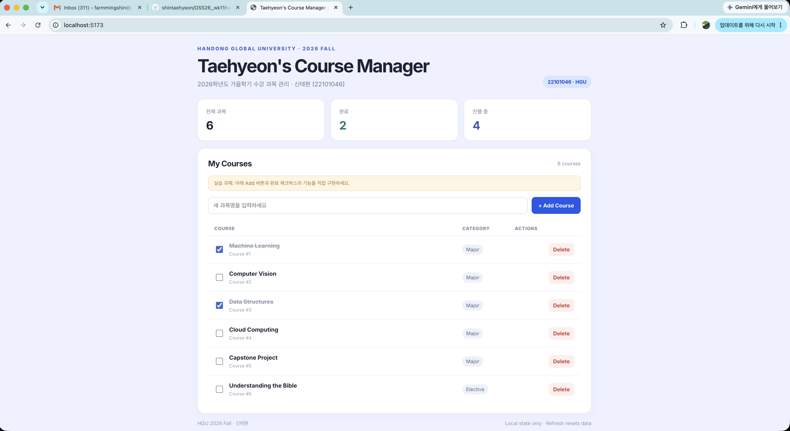

# Taehyeon's Course Manager (2026 Fall · HGU)

> 한동대학교 2026학년도 가을학기 수강 과목 관리를 위한 **React + Vite** 기반 웹 애플리케이션입니다.  
> 기존 Sample Project를 커스터마이징하고, 과목 등록(Create) · 완료 토글(Update) · 검색 및 상태별 필터링 기능을 구현하여 Vercel에 배포했습니다. 맨밑에 최신 README 가 있습니다.

- **작성자**: 신태현 (22101046)
- **GitHub Classroom**: https://github.com/2026-2-OSS/assign11-c02-22101046
- **Vercel 배포 URL**: https://oss26wk11hw1.vercel.app/
- **원본 Sample Project**: https://github.com/2026-2-OSS/week11_sample_project

---

# OSS Week 11 — React Course Manager (Student Starter)

React + Vite 기반 학생 배포용 Sample Project입니다. **조회와 삭제는 완성**, 등록 및 완료 변경은 학생이 직접 구현하도록 `TODO`로 남겨두었습니다.

## 실행 방법

Node.js 20.19+ 또는 22.12+ 권장.

```bash
npm install
npm run dev
```

브라우저에 표시되는 Local URL에 접속하세요. 빌드 테스트: `npm run build`.

## 소스 구조

- `src/App.jsx`: 페이지 전체 레이아웃
- `src/components/CourseList.jsx`: State 및 목록, 삭제 로직, **TODO 1/2**
- `src/components/CourseItem.jsx`: Props로 데이터를 받고 이벤트 콜백 호출
- `src/data/courses.js`: 초기 과목 데이터
- `src/App.css`: 전체 디자인

## 수행 내용

1. 코드를 실행하고 목록 조회·삭제를 확인합니다.
2. 초기 과목 5개 이상, 제목, CSS 3곳 이상 변경합니다.
3. `CourseList.jsx`의 **TODO 1**: 과목 등록 (빈 값 입력 방지, 고유 id 지정, State 업데이트).
4. `CourseList.jsx`의 **TODO 2**: 완료 체크박스 클릭 시 `completed` 상태 변경.
5. 선택: 검색/필터, 이름 수정 기능 추가.
6. GitHub에 Commit/Push 후 Vercel에 배포합니다.
7. README에 프로젝트 소개, 주요 코드 분석 2개, 변경 내용, Weekly Review, GitHub URL, Vercel URL을 정리합니다.

## 확인할 질문

- `CourseList`와 `CourseItem`의 역할은?
- 왜 `courses`를 직접 수정하지 않고 `setCourses()`를 사용할까요?
- `map()`과 `filter()`는 각각 어떤 목적인가요?
- `course`, `onDelete`, `onToggle` Props는 어디에서 전달되나요?
- 브라우저 새로고침 시 데이터가 초기화되는 이유는? (DB/localStorage 없음)

> 교육 목적의 로컬 State 앱입니다. 서버 API 및 데이터베이스는 사용하지 않습니다.


========================================================

22101046 신태현 11wk 

## STEP 2. 소스코드 분석

### 1. Project Structure (주요 파일 3개 역할)
- `src/App.jsx`: 앱의 전체 레이아웃(헤더, `CourseList` 컴포넌트, 푸터)을 구성하는 최상위 컴포넌트입니다.
- `src/components/CourseList.jsx`: `useState`로 과목 목록(`courses`)과 입력값(`newName`) 상태를 관리하고, 과목 추가/삭제/완료 토글 로직을 처리하는 부모 컴포넌트입니다.
- `src/components/CourseItem.jsx`: 부모(`CourseList`)로부터 과목 데이터와 이벤트 함수를 Props로 전달받아 개별 과목 한 줄을 화면에 렌더링하는 자식 컴포넌트입니다.

### 2. Component & Props (`CourseList`와 `CourseItem`의 관계)
- `CourseList`가 부모 컴포넌트, `CourseItem`이 자식 컴포넌트입니다.
- `CourseList`는 `courses.map()`을 사용해 과목 배열을 순회하면서 각 과목마다 `<CourseItem />`을 생성합니다.
- 이때 `course`(과목 객체), `onDelete`(삭제 핸들러), `onToggle`(완료 토글 핸들러)을 Props로 전달하고, React가 각 항목을 구분할 수 있도록 `key={course.id}`를 함께 넘깁니다.

### 3. State & Event (`useState` 상태 관리 및 삭제 버튼 동작 원리)
- `CourseList`는 `useState(initialCourses)`를 통해 과목 목록을 React 상태(State)로 관리합니다. 일반 변수와 달리 `setCourses`로 상태를 변경하면 React가 변경을 감지해 화면을 자동으로 리렌더링합니다.
- `CourseItem`에서 `Delete` 버튼을 클릭하면 `onClick={() => onDelete(course.id)}`가 실행되어 부모의 `handleDelete(id)`를 호출합니다.
- `handleDelete`는 `filter()`를 이용해 클릭한 `id`와 다른 과목들만 남긴 **새 배열**을 만들어 `setCourses`에 전달함으로써, 원본 배열을 직접 수정하지 않고(불변성 유지) 해당 과목을 삭제합니다.

### 4. Code Analysis (주요 코드 2개 분석)

#### 코드 ①: `src/components/CourseList.jsx` (State 선언 및 삭제 핸들러)
```jsx
export default function CourseList() {
  const [courses, setCourses] = useState(initialCourses);
  const [newName, setNewName] = useState('');

  function handleDelete(id) {
    if (!window.confirm('이 과목을 삭제하시겠습니까?')) return;
    setCourses(previous => previous.filter(course => course.id !== id));
  }
```
- **동작 원리**: `initialCourses`를 초기값으로 `courses` 상태를 생성합니다. `handleDelete(id)`가 호출되면 `window.confirm`으로 사용자 확인을 받은 뒤, `previous.filter(...)`로 해당 `id`를 제외한 새 배열을 반환하여 상태를 업데이트합니다.

#### 코드 ②: src/components/CourseList.jsx (목록 렌더링 및 Props 전달)
```jsx
        <div className="list-head"><span>COURSE</span><span>CATEGORY</span><span>ACTIONS</span></div>
        {filteredCourses.length === 0 && <div className="empty">조건에 맞는 과목이 없습니다.</div>}
        {filteredCourses.map(course => (
          <CourseItem key={course.id} course={course} onDelete={handleDelete} onToggle={handleToggle} />
        ))}
      </section>
```
- **동작 원리**: 조건부 렌더링(&&)으로 검색/필터 조건에 맞는 과목이 없을 때 안내 문구를 띄우고, 과목이 있으면 filteredCourses.map()으로 배열의 각 요소를 CourseItem 컴포넌트로 변환해 화면에 출력하며 course, onDelete, onToggle Props와 고유 key를 전달합니다.


## STEP 3. 커스터마이징 변경 내역
- `src/data/courses.js`: 초기 과목을 6개(전공 5, 교양 1)로 변경
- `src/App.jsx`, `index.html`: 제목, 부제목, 태그, 브라우저 탭 제목을 본인 학번/학교/학기 정보로 변경
- `src/App.css`: 배경색, 상단 태그 배지, Primary 버튼 색상, 과목 행 호버 효과 등 CSS 스타일 4곳 변경


## STEP 4. 구현한 기능
- **필수 기능 ① 과목 등록 (Create)**: `handleAdd`에서 `trim()`으로 빈 문자열 및 공백 입력을 방지하고, `Date.now()`로 고유 `id`를 생성해 `setCourses`로 새 과목을 추가합니다.
- **필수 기능 ② 완료 상태 변경 (Update)**: `handleToggle`에서 `map()`과 Spread(`...`) 문법으로 해당 과목의 `completed` 상태를 반전시켜 취소선 및 통계 카운터가 즉시 갱신되도록 구현했습니다.
- **선택 기능 (검색 및 필터링)**: `searchTerm`과 `filter` 상태를 추가하여 과목명 대소문자 구분 없는 실시간 검색과 전체/진행 중/완료 상태별 필터링을 구현했습니다.

```jsx

// 1. 과목 등록 (빈 값 방지 및 새 배열 생성)
const trimmed = newName.trim();
if (!trimmed) { window.alert('과목명을 입력하세요.'); return; }
setCourses(previous => [...previous, { id: Date.now(), name: trimmed, category: 'Major', completed: false }]);
// 2. 완료 상태 토글 (map + spread로 불변성 유지)
setCourses(previous =>
  previous.map(course => course.id === id ? { ...course, completed: !course.completed } : course)
);
// 3. 검색 및 완료 여부 필터링
const filteredCourses = courses.filter(course => {
  const matchesSearch = course.name.toLowerCase().includes(searchTerm.trim().toLowerCase());
  if (filter === 'completed') return matchesSearch && course.completed;
  if (filter === 'active') return matchesSearch && !course.completed;
  return matchesSearch;
});

```

### 동작 결과
- 과목 등록: 빈 입력 시 경고창으로 등록이 차단되며, 과목명 입력 후 추가 시 목록과 상단 전체 과목/진행 중 통계가 즉시 갱신됩니다.
- 완료 토글: 체크박스 클릭 시 과목명에 취소선이 적용되고 상단 완료/진행 중 숫자가 실시간으로 바뀝니다.
- 검색 및 필터링: 검색어 입력 및 드롭다운(전체 보기/진행 중/완료) 선택에 따라 일치하는 과목만 즉시 필터링되어 표시됩니다.

### 실행 화면




## STEP 5. Weekly Review:
- **배운내용 3 가지 , 어려웠던점과 해결법**

**①React의 Props와 State:** Props는 부모가 자식에게 전달하는 읽기 전용 값이고, State는 컴포넌트가 관리하는 변경 가능한 값이야. useState로 상태를 바꾸면 화면이 다시 렌더링됨. 
**②이벤트와 배열 처리:**  버튼 클릭 같은 이벤트로 함수를 실행하고, map·`filter`·`...`을 사용해 기존 배열을 직접 바꾸지 않고 새 배열을 만들어 목록을 추가·수정·삭제
**③리스트 렌더링과 Key:** map()으로 컴포넌트 목록을 렌더링할 때, React가 항목의 추가·수정·삭제를 정확히 구별할 수 있도록 각 요소에 고유한 key 값을 지정해. 이때 배열의 index 대신 데이터의 고유 ID(key={course.id})를 사용


**① Props와 State의 차이**
처음에는 두 개념 모두 데이터를 다루기 때문에 차이를 구분하기 어려웠다. Props는 부모가 자식에게 전달하는 읽기 전용 값이고, State는 컴포넌트가 직접 관리하고 변경하는 값으로 정리했다. useState로 State를 변경하면 화면이 다시 렌더링된다는 점도 예제를 통해 이해했다.

**② 이벤트와 배열 처리**
버튼을 클릭했을 때 함수가 실행되고 목록이 바뀌는 과정이 헷갈렸다. 예제 코드를 따라가며 onClick에 함수를 전달하는 방법을 확인했다. 또 기존 배열을 직접 수정하지 않고 map, filter, 전개 연산자(...)로 새 배열을 만들어 State를 갱신하는 방법을 추가·수정·삭제 기능별로 비교하며 정리했다.

**③ 리스트 렌더링과 Key**
map()으로 목록을 출력할 때 왜 key가 필요한지 처음에는 이해하기 어려웠다. React가 항목의 추가·수정·삭제를 구별할 때 각 요소를 안정적으로 식별하기 위한 값이라는 것을 알게 됐다. 배열의 순서가 바뀔 수 있으므로 index보다 key={course.id}처럼 데이터의 고유 ID를 사용하는 것이 좋다는 점도 배웠다.

## AI 사용

#### 1. 본인이 직접 수행한 작업
- **개발 환경 세팅 및 실행**: 샘플 프로젝트 클론, `npm install`, `npm run dev` 실행 및 `npm run build` 프로덕션 빌드 검증
- **커스터마이징 기획 및 구현**:
  - 한동대학교 2026 가을학기 컨셉과 본인 학번/이름 반영 (`src/App.jsx`, `index.html`)
  - 실제 수강/관심 과목 6개(전공 5, 교양 1) 선정 및 데이터 구성 (`src/data/courses.js`)
  - 배경색, 태그 배지, Primary 버튼, 행 호버(`:hover`) 등 CSS 4곳 직접 수정 (`src/App.css`)
- **핵심 React 기능 직접 코딩 및 테스트**:
  - `handleAdd`(빈 값 방지 + 과목 등록), `handleToggle`(완료 상태 반전), `filteredCourses`(검색 + 상태별 필터링) 구현 및 스타터 안내 배너 제거 (`src/components/CourseList.jsx`)
  - 브라우저에서 등록·빈 입력 방지·완료 토글·검색·필터·삭제 기능 직접 테스트
- **문서화, Git 버전 관리 및 배포 전 과정**:
  - `README.md` 분석 내용, 변경 내역, 주요 코드, 실행 화면 캡처 및 Weekly Review 직접 작성
  - 기능/수정 단위별 커밋 직접 실행 및 GitHub Classroom(`origin`)·개인 레포(`personal`) 양쪽 Push
  - Vercel 연동·배포, Auto Deploy 확인 및 배포 URL 동작 검증

#### 2. AI를 활용한 작업 (단계별 멘토 & 코드 리뷰)
- **개념 학습 및 문법 질의응답**: React `useState` 불변성(`map`, `filter`, Spread `...`), Props/Callback, CSS `:hover`, Markdown 문법(백틱 코드 블록, 이미지 삽입) 등의 원리를 질문하며 학습
- **디버깅 및 코드 리뷰(QA)**:
  - 흰 화면 오류(`App.jsx` 레이아웃 누락), `handleAdd` 문법 오타(`trimmed`, 쉼표, `=>`), `handleToggle` 함수 중첩 실수를 진단받고 직접 수정
- **작성 참고**: 과목명 영문 표기 및 `README.md` 마크다운 문법 참고


### AI 활용 소감
> AI의 발전 속도가 정말 빨라서 개발자가 일하기 훨씬 편한 환경이 되었다는 걸 체감했고, 동시에 그 속도가 한편으로 무섭게 느껴지기도 했습니다.  
> 하지만 이번 과제처럼 코드를 직접 작성하고 기초를 탄탄히 다지면서 정진한다면, AI는 개발자의 역량을 극대화해 주는 강력한 무기가 되어 실력이 일취월장할 수 있을 것이라는 확신이 들었습니다.  
> 무엇보다 옆에 개인 튜터가 있는 것처럼 든든하게 질문하고 디버깅할 수 있어서, 과제 구현뿐만 아니라 React와 Git 개념 복습까지 정말 알차게 마칠 수 있었습니다.


## 배포 및 저장소 링크

- **GitHub Classroom Repository** : https://github.com/2026-2-OSS/assign11-c02-22101046
- **Vercel 배포 URL** :  https://oss26wk11hw1.vercel.app/
-**원본 샘플 URL** : https://github.com/2026-2-OSS/week11_sample_project

  


